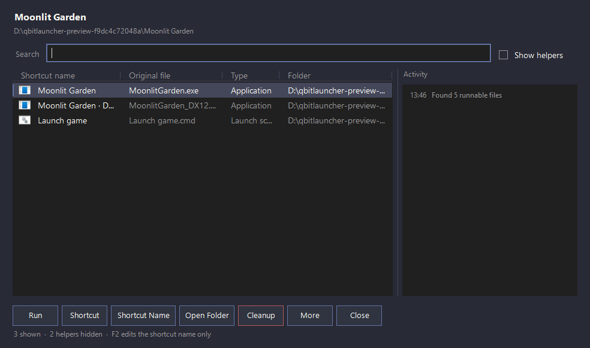
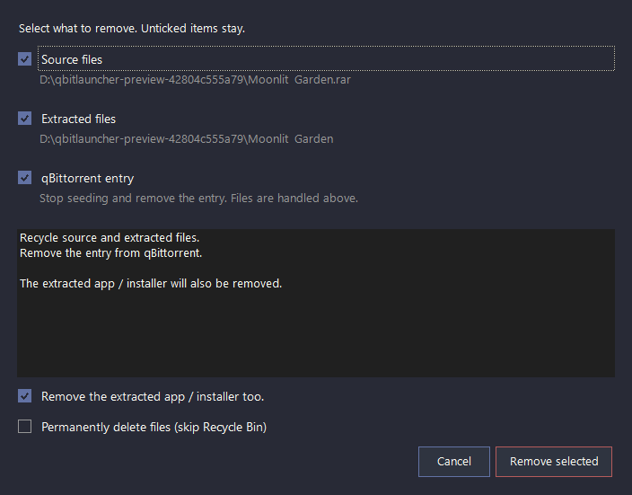

<p align="center">
  
</p>

# qBitLauncher

qBitLauncher opens when a qBittorrent download finishes, helps you extract it, and shows the EXE, BAT, or CMD files you can run. You can also open folders and archives from Windows Explorer.



[Download](https://github.com/DeonHolo/qBitLauncher/releases/latest) · [Usage](Docs/usage.md) · [Project wiki](Docs/wiki/Home.md) · [Troubleshooting](Docs/wiki/Troubleshooting.md) · [Development](Docs/development.md)

## Get started

You need Windows 10 or 11 with Windows PowerShell 5.1. Install [7-Zip](https://www.7-zip.org/) or [WinRAR](https://www.win-rar.com/) to extract archives. You can scan folders and create shortcuts without either extractor.

1. Download `qBitLauncher.exe` from [Releases](https://github.com/DeonHolo/qBitLauncher/releases/latest) and open it.
2. Choose an installation folder or portable mode.
3. Close qBittorrent completely, then use **Install / update qBittorrent integration** in the dashboard.
4. Optionally add the **Shift+right-click context menus** for Explorer. **Choose a folder...** works without either integration.

qBittorrent sends the finished download to qBitLauncher. Choose an extraction destination, reuse an existing extracted folder, or skip extraction and scan the original folder. The destination base is remembered. RAR files prefer WinRAR; other supported archives prefer 7-Zip. The extractor shows its own progress and cancellation controls.

Different games can extract at the same time. A large extraction or an open result window does not hold up another game. Opening the same source twice is blocked to prevent duplicate extraction.

To return after closing a window, open qBitLauncher without a file, choose a game under **Recent sessions**, and click **Reopen session**. The session remembers its source, extracted folder, and torrent identity. It opens the saved game folder without extracting again. **Open extracted files** in the archive dialog also opens the chosen destination directly.

From an open game window, use **More → Reopen saved session → game** to open another saved game in a separate window. The current session stays open.

Scanning shows the current folder, elapsed time, and counts of checked files and discovered runnables. **Use files found** stops the remaining scan and opens the results already available. **Cancel** closes the scan without waiting for disk I/O. After extraction, qBitLauncher checks expected filenames and sizes when 7-Zip can list the archive, and reports incomplete output with its destination.

## Find the right file

Search matches shortcut names and original file paths, including non-English characters. Likely applications and installers appear ahead of support tools; **Show helpers** reveals uninstallers, crash handlers, and maintenance tools. This ranking uses filenames and paths, so check the original file before running it.

Select a file and click **Run**. **More → Launch options** opens the arguments field and administrator checkbox. qBitLauncher remembers these choices for each file, along with the preferred executable for each folder, recent folders, and window and column sizes. New files use administrator mode by default; change that under **More → Settings**.

## Name a desktop shortcut

Press **F2**, double-click a row, or click **Shortcut Name** to edit the name for a future desktop shortcut. **Enter** saves, **Escape** cancels, and clicking outside saves.

For example, give `setup.exe` the shortcut name `Game Installer`. Clicking **Shortcut** creates `Game Installer.lnk` on the desktop. The original file stays named `setup.exe`; changing the label also leaves existing desktop shortcuts alone. This works for EXE, BAT, and CMD files, including non-English filenames and folders.

Shortcuts use the selected target, its working folder, and saved launch arguments. If a shortcut already has that name, choose to replace it, keep both with a numbered name, or cancel. The administrator checkbox controls launching from qBitLauncher; it does not make desktop shortcuts always request elevation.

## Remove what you no longer need

Open **Cleanup** and tick any combination:

| Item | What it removes |
| --- | --- |
| **Source files** | The original archive or download contents. Unticked extracted files stay on disk, even when they are inside the source folder. |
| **Extracted files** | The extracted folder, which may contain an installer or the game itself. Removing it requires acknowledgement when it includes the extracted app or selected file. |
| **qBittorrent entry** | The torrent entry. File deletion is controlled by the two checkboxes above. This option needs a torrent hash from qBittorrent. |

Tick all three to remove the source, extracted files, and torrent entry together. Local files go to the Recycle Bin by default. **Permanently delete files (skip Recycle Bin)** requires another confirmation.

If the extracted folder is the playable game, leave **Extracted files** unticked. If it only contains an installer you have finished using, you can remove it. qBitLauncher shows the locations and checks the removal plan; it cannot decide which files you still need.



Screenshots use disposable example files. [The usage guide](Docs/usage.md#cleanup-choose-what-to-keep) covers overlapping locations, junctions, and failed cleanup steps.

## Manual qBittorrent setup

In qBittorrent, open **Tools → Options → Downloads** and enable **Run on torrent finished** under **Run external program**. Use your actual installation path:

```text
"C:\path\to\qBitLauncher.exe" "%F" "%I" "%N"
```

`%F` is the content path, `%I` the torrent hash, and `%N` the torrent name. The hash enables the cleanup checkbox for the qBittorrent entry. Explorer and manual folder workflows can still remove local source or extracted files.

To run the standalone script instead:

```text
powershell.exe -WindowStyle Hidden -ExecutionPolicy Bypass -File "C:\path\to\qBitLauncher.ps1" "%F" "%I" "%N"
```

## Settings, logs, and updates

**More → Settings** contains the dark and light themes, extraction base folder, launch default, update checks, and qBittorrent API URL and credentials. Torrent removal uses qBittorrent's local API. Repair previews its changes and preserves existing authentication settings; enter the existing API credentials if localhost requires a login.

Settings stay in `config.json` beside the app. Saved API passwords are encrypted for the current Windows user. If you move the config to another Windows account, re-enter the password through Settings. Shortcut labels and launch preferences follow the original file path.

**More → Open Log** opens `%LOCALAPPDATA%\qBitLauncher\logs\qBitLauncher.log`. **Copy Error** copies the last error with credentials redacted. Separate windows merge saved changes so one game's settings do not overwrite another's.

Update checks run in the background. When an update is available, Settings offers to install it. Downloads are checked against a published SHA-256 checksum, and replacement keeps a rollback backup.

## Supported files

| Type | Extensions |
| --- | --- |
| Runnables | `exe`, `bat`, `cmd` |
| Archives | `zip`, `rar`, `7z`, `iso`, `img`, plus first `zip.001` and `7z.001` volumes |

For multipart archives, keep the remaining volumes beside the first. The installed extractor handles the archive contents. When there is no runnable or supported archive, qBitLauncher opens the folder for inspection.

## Build from source

Edit the files in `Source/`, then run this from the repository root:

```powershell
powershell.exe -NoProfile -ExecutionPolicy Bypass -File .\Build.ps1
```

The build generates the standalone `qBitLauncher.ps1`, runs the Windows checks, compiles the EXE with PS2EXE 1.0.17, and writes `SHA256SUMS.txt`. It preserves the previous executable and does not terminate a running app. `Compile.ps1` uses the same build.

See [Development](Docs/development.md) for individual checks, staged builds, and the release workflow. qBitLauncher is released under the [MIT License](LICENSE).
